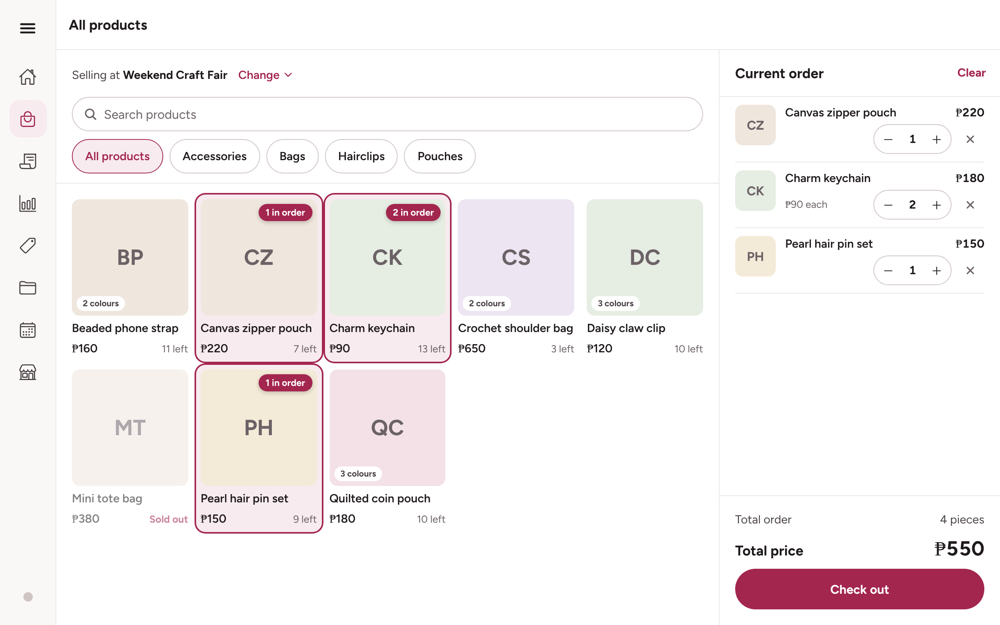
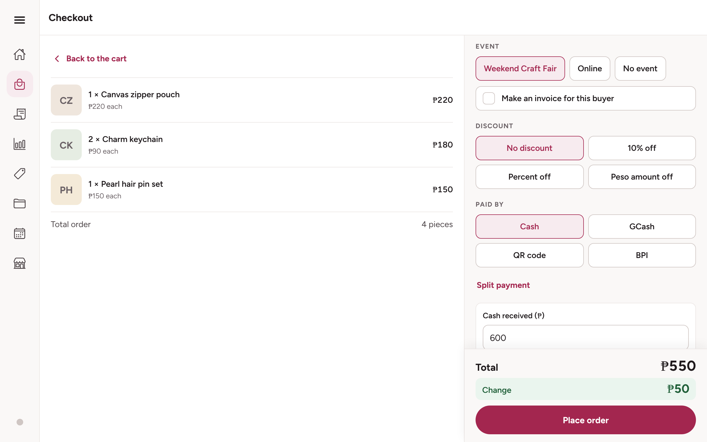

# caracebu: Offline-first point of sale

A cashier and inventory app I built for **caracebu**, a small Cebu-based shop that sells at pop-up events. The owner sells on an iPad at events, manages products on a computer, and checks orders and reports anywhere. The app keeps selling with no internet and syncs both devices once they're back online.

**[🛍️ Public catalog (live)](https://caracebu.expo.app)** · [Setup guide](docs/SETUP.md) · [Design decisions](docs/BRIEF.md)



<details>
<summary>Checkout screen</summary>



</details>

<sub>Screenshots use the app's built-in sample products (device-only mode), not real shop data.</sub>

---

## The problem

Pop-up events have unreliable Wi-Fi, and the shop was tracking sales by hand. The owner needed something that:

- works **fully offline** during an event and never loses a sale,
- keeps **stock correct** when the iPad and the computer both make changes,
- costs **nothing** to run (no App Store fees, a free database tier),
- gives customers a **public product catalog** without exposing business data.

## Features

- **Fast checkout:** a product grid with colour variants, discounts, cash change and split payments.
- **Offline selling:** sales are saved on the device and upload automatically when the connection returns. The sidebar shows how many are waiting.
- **Two-device sync** between the iPad and the computer through Supabase.
- **Inventory:** stock is worked out from counts and sales, with "Low on stock" and "Sold out" states.
- **Orders, invoices and receipts:** PNG or one-page PDF documents are generated in the browser, even offline. Invoiced orders can wait as "Not paid yet".
- **Reports per event,** plus CSV export.
- **Public catalog:** visitors can browse products, prices and availability, but never stock counts or orders.
- **Installable web app (PWA):** added to the iPad's Home Screen, with no App Store needed. It updates safely and never swaps versions mid-sale.

## Tech stack

| Area | Tools |
| --- | --- |
| App | Expo (React Native + React Native Web), Expo Router, TypeScript |
| Data | Supabase (Postgres, Auth, Storage), IndexedDB on the device |
| Offline | Service worker (Workbox), a local outbox, custom sync and merge logic |
| Security | Postgres row-level security; owner-only access; a public read-only catalog function |
| Testing | Node test runner (domain logic), PGlite (the database migration and access rules in real Postgres) |
| CI | GitHub Actions (scheduled keep-alive for the free Supabase project) |

## Engineering highlights

- **Offline-first sync with an outbox.** Every change is written locally first and queued. `src/data/sync.ts` uploads the queue and pulls the other device's changes, and the newer change wins.
- **Conflict-free stock.** Stock is never stored as a single number that two devices could overwrite. It's derived from stock changes (what was counted) minus what orders sold, so offline sales and computer edits add up correctly after syncing.
- **Safe order numbering across offline devices.** If two offline devices pick the same order number, the server gives the later upload the next free number.
- **Money as integers.** All amounts are stored in centavos, so floating-point rounding never touches money.
- **Database rules are tested.** `npm run test:db` runs the Supabase migration in an in-process Postgres (PGlite) and checks the access rules and uploads.
- **Pure, tested domain layer.** Totals, discounts, split payments, stock, reports, CSV and invoice content live in `src/domain/` with no UI dependencies.

## Project structure

```
src/app/      screens (Expo Router): sell, checkout, orders, products, events, reports, shop
src/domain/   pure business logic + tests: money, checkout, stock, reports, CSV, documents
src/data/     local store + outbox, Supabase sync, public catalog, storage adapters
src/ui/       shared components and design tokens
supabase/     database schema, access rules and their tests
public/       PWA manifest, icons, service worker registration
```

## Run it locally

Requires Node.js 20+.

```bash
git clone https://github.com/shuu-pao/e-commerce-app.git
cd e-commerce-app
npm install
npm run web          # http://localhost:8081
```

Without Supabase keys the app runs on one device with no sign-in and no sync. On the empty Sell screen, tap **Try it with sample products** to load sample data.

| Command | What it does |
| --- | --- |
| `npm test` | Domain tests: money, discounts, split payment, stock, reports, CSV, sync merging |
| `npm run test:db` | Supabase migration and access rules in real Postgres (PGlite) |
| `npm run typecheck` | TypeScript (run `npx expo start` once first to generate `.expo/types`) |
| `npx expo lint` | Lint |
| `npm run build:web` | Production web build and service worker in `dist/` |

To connect Supabase, publish the site or install it on an iPad, see the **[setup guide](docs/SETUP.md)**.

## About the author

**Paolo Jansen Enrera**, Software Engineering Associate at Accenture and BS Computer Engineering graduate of the University of San Carlos, Cebu. I build web and mobile apps as personal projects. I built this one for a real small business.

[LinkedIn](https://www.linkedin.com/in/paolo-jansen-enrera/) · [GitHub](https://github.com/shuu-pao)
